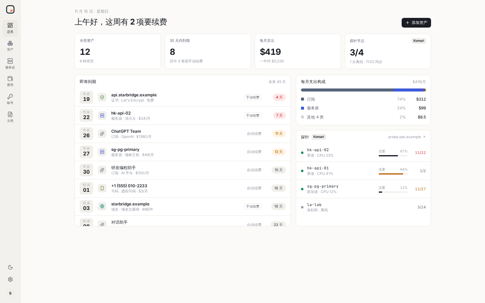
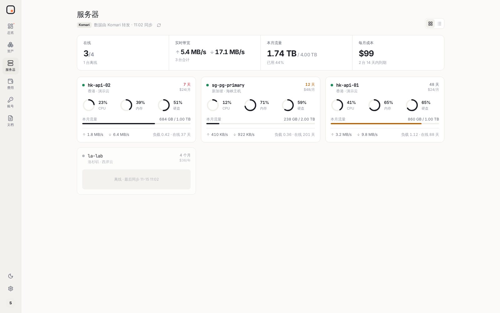

<p align="center"></p>

<h1 align="center">方寸 Fangcun</h1>

<p align="center">个人资产台账 —— 服务器、域名、证书、订阅、邮箱、号码、支付卡、账号、文档的<b>到期与费用</b>，一处管理。</p>

<p align="center">自托管 · 单用户 · SQLite · 只读接入 Komari 探针 · CLI / MCP 给 AI 代理用 · MIT</p>



## 方寸是什么

手上的东西一多——几台 VPS、一堆域名和证书、AI 订阅、团队席位、虚拟卡、接码号码——就很难记清楚**哪个快到期、每月到底花多少、谁用哪张卡付的**。方寸把它们放进一张台账：

- **统一资产列表**：9 种类型（服务器 / 域名 / 证书 / 订阅 / 邮箱 / 号码 / 支付 / 账号 / 文档），按到期日排序，类型筛选、全文搜索（名称、IP、标签、卡号末四位…）。
- **到期提醒**：红色 = 7 天内（含已过期），橙色 = 14 天内，其余保持中性。「标记已续费」会把到期日推进一个周期并记一条续费记录。
- **费用**：价格一律**按实付手填**（区域价、折扣都按你真正付的钱记），币种、周期、区域 / 折扣标签自己写，单项价格**不做换算**；总览里的「约」合计按汇率折算，汇率默认每 6 小时自动更新（欧洲央行参考汇率 via Frankfurter，缺的币种用 open.er-api 补，无需密钥），也可以在设置里关掉改成手填。
- **团队订阅**：母号 → 工作空间（各自价格、区域、折扣、席位、到期）→ 成员。资产总价 = 各空间合计，到期 = 最早到期的空间，显示人均成本。
- **支付卡**：发卡平台、卡组织、**卡号末四位**、有效期（参与到期提醒）、年费 / 月费、开卡费 / 充值手续费、账单地区、状态（正常 / 冻结 / 已注销）。通过「关联」挂到订阅、服务器上表示用这张卡付款。**方寸绝不保存完整卡号和 CVV**——服务端会拒绝任何看起来像完整卡号（13–19 位且通过 Luhn 校验）或名为 cvv / cardNumber 的字段。
- **号码**：号码、运营商 / 平台、国家、用途、保号 / 续费到期、月租。
- **关联、标签、备注、附件**：文档类资产可以上传合同、发票等附件，随完整备份一起导出。
- **服务器页**：在线数、实时带宽、本月流量、每月成本，以及每台机器的 CPU / 内存 / 硬盘 / 流量 / 负载卡片（数据来自 Komari，由方寸服务端转发）。
- **Atoll 只读接入**：读取 Atoll 面板的项目 / 服务 / 域名，VPS 详情里看到「这台机器上跑着哪些项目」，域名详情里看到「哪些服务指向这个域名」，快到期时提示「影响 N 个 Atoll 项目」。

方寸只是台账：**不做 SSH、终端、SFTP，不采集监控，不对任何服务器做任何操作。**

| 服务器 | 服务器详情 | 支付卡 |
| --- | --- | --- |
|  |  |  |

## 快速开始

### Docker（推荐）

镜像：`ghcr.io/sakuralaaa/fangcun:latest`（amd64 / arm64，每次发版打 `v*` 标签时自动构建，同时有 `latest` 和版本号标签，如 `0.1.0`）。

在任意 Docker 面板里直接拉这个镜像即可，要点：

- 端口：容器 `8080`
- 数据卷：容器 `/data`（数据库、附件、自动备份都在这里，务必挂载）
- 环境变量（可选）：`KOMARI_API_KEY`（Komari 管理员 API Key，只读使用）、`ATOLL_API_KEY`（Atoll 只读令牌，见下文「Atoll 接入」）、`TZ=Asia/Shanghai`、`COOKIE_SECURE=1`（走 HTTPS 反代时）

或用 compose：

```bash
mkdir fangcun && cd fangcun
curl -fsSLO https://raw.githubusercontent.com/Sakuralaaa/fangcun/main/docker-compose.yml
echo "KOMARI_API_KEY=你的 Komari API Key" > .env   # 可选
echo "ATOLL_API_KEY=atl_pat_你的只读令牌" >> .env    # 可选
docker compose up -d
```

打开 `http://服务器:8080`，**第一次访问时设置管理员账号和密码**（单用户，密码 scrypt 哈希存储），之后可在「设置 → 登录与两步验证」绑定 TOTP。

想自己构建：

```bash
docker buildx build --platform linux/amd64,linux/arm64 -t fangcun:latest .
```

放在 HTTPS 反向代理（Caddy / Nginx）后面时建议设 `COOKIE_SECURE=1`；代理会转发 `X-Forwarded-Proto: https` 时会自动带 Secure。

### 从源码运行

需要 Node.js ≥ 22.13（使用内置的 `node:sqlite`，无需编译原生模块）。

```bash
npm install
npm run build          # web + server + cli
npm test               # vitest
FANGCUN_DATA_DIR=./data KOMARI_API_KEY=xxx npm start   # http://localhost:8080
```

开发模式：`npm run dev:server`（8080）+ `npm run dev:web`（Vite，自动把 /api 代理到 8080）。

不连服务端、只看界面：打开 `http://localhost:5173/?demo=1`（演示数据，改动只留在浏览器内存里）。

### 环境变量

| 变量 | 默认 | 说明 |
| --- | --- | --- |
| `PORT` / `HOST` | `8080` / `0.0.0.0` | 监听地址 |
| `FANGCUN_DATA_DIR` | `./data`（镜像里 `/data`） | 数据库、附件、备份 |
| `FANGCUN_BACKUP_DIR` | `$FANGCUN_DATA_DIR/backups` | 自动备份目录 |
| `KOMARI_API_KEY` | — | Komari 管理员 API Key，只放在服务端，不进数据库、不进备份 |
| `ATOLL_API_KEY` | — | Atoll 的**只读（read）**API 令牌（`atl_pat_…`），只放在服务端，不进数据库、不进备份、不发给浏览器 |
| `COOKIE_SECURE` | 自动 | `1` 强制 Secure cookie，`0` 关闭 |
| `TZ` | 系统 | 每日自动备份按此时区判断日期 |

## Komari 接入（只读）

适配 Komari 1.2.5。在「设置 → Komari 探针」填写探针地址，API Key 由服务端环境变量 `KOMARI_API_KEY` 提供。

Komari 的 API Key 在它的管理后台「设置 → 登录」页最下方的「API 密钥」里点「生成」再保存（以 `komari-` 开头）。这把密钥在 Komari 那边是完整管理权限，方寸只用它读取节点列表和状态，请只放在环境变量里。

- **方寸只会发出下面这些只读请求**，其余在发出前就被代码拦截（并有测试保证）：
  - `GET /api/admin/client/list` —— 节点信息（响应里的 agent token 一到就丢弃，从不存储或转发）
  - `POST /api/rpc2`，方法仅限 `common:getNodesLatestStatus`（运行状态）和 `common:getVersion`
  - `POST /api/rpc2` 的 `common:getRecords`，参数只允许 `type: "ping"`（近 1 小时延迟记录，每分钟最多一次）；Komari 里没有延迟检测任务或接口不可用时，服务器页隐藏延迟/丢包行
  - 绝不调用任何写接口、exec 或终端接口。
- **按 uuid 绑定**：节点可以绑到已有的服务器资产，或一键新建。
- **同步字段**（每组可在设置里开关）：价格与币种、续费周期、到期日、自动续费、配置与系统（CPU / 内存 / 硬盘 / OS）、IP 与地区、标签。
- **已手动修改**：你在方寸里改过的同步字段会标「已手动修改」，之后同步不会覆盖；Komari 那边的值变了会提示「Komari 已变为 …」，可一键恢复。
- **运行状态**：浏览器只连方寸，不直连 Komari。有人在看时前端每 10 秒轮询，方寸服务端合并请求、8 秒内复用；没人看时后台每 5 分钟刷新一次缓存。
- **服务器页**：在线节点、累计流量、实时带宽、资产概览（按设置里的汇率换算）四张汇总卡；按 Komari 分组（没有分组时按标签）筛选；大卡片 / 紧凑卡片 / 列表三种布局（记在本机）。CPU、内存、磁盘、负载、剩余流量用分段条显示，80% 以上转橙、90% 以上转红。
- **流量重置日**在方寸里手填（资产编辑 → Komari → 流量重置日）。流量用量按 Komari 的 `traffic_limit_type`（sum / max / min / up / down）计算。

## 访问令牌与权限

「设置 → 访问令牌」可以生成给 CLI / AI 代理用的令牌：可命名、可设过期、可随时吊销，明文只显示一次（库里只存 SHA-256）。

| 权限 | 能做什么 |
| --- | --- |
| **只读** | 查询、搜索、导出、doctor |
| **可写（需审批）** | 所有写操作先生成**变更计划**，在网页「设置 → 变更审批」里看到逐字段 diff，批准后才落库；计划生成后资产又被改过则判为冲突，不会覆盖 |
| **完全权限** | 直接写入（含删除到回收站、改 Komari 绑定、备份 / 恢复） |

无论哪种：

- 令牌**不能**管理令牌、批准计划、改登录设置；
- 所有写入（网页、CLI、AI 代理、Komari 同步）都记**操作日志**，可以逐条**撤销**；
- 删除先进**回收站，30 天**后自动永久删除；
- 账号类资产在 v0.1 不存任何密码（保险库见路线图），API 也不会返回密钥类字段。

## CLI：`fangcun`

```bash
npm run build -w apps/cli         # 生成 apps/cli/dist/fangcun.js（单文件）
alias fangcun="node $PWD/apps/cli/dist/fangcun.js"   # Docker 镜像里已自带 fangcun 命令

fangcun config --url https://fangcun.example.com --token fc_xxx   # 或 FANGCUN_URL / FANGCUN_TOKEN
fangcun ls --due 30                       # 30 天内到期
fangcun ls --type payment --json
fangcun show hk-api-02
fangcun search 192.0.2
fangcun add --type domain --name example.dev --price 12 --currency USD --cycle year --expires 2027-06-11 --tags 个人
fangcun add --type payment --name "美元虚拟卡" --set payment.issuer=某数字银行 --set payment.network=Visa \
            --set payment.last4=4242 --set payment.cardExpiry=2028-09 --set payment.status=active
fangcun edit hk-api-02 --set price=24 --set note="续费前确认流量"
fangcun tag ai-chat +个人 -工作
fangcun link ai-code card-wise            # 双向关联：这个订阅用这张卡付款
fangcun renew starbridge --amount 88 --note 手动续费
fangcun rm la-lab                         # 进回收站
fangcun import assets.csv                 # 或 .json
fangcun export --format csv -o all.zip    # json | csv | ics
fangcun doctor                            # 缺字段、重复、过期未处理、无关联、断开的关联
fangcun log --limit 20
fangcun undo 42
fangcun plans                             # 待审批的变更计划
fangcun backup -o fangcun.fangcun         # 需要完全权限令牌
fangcun restore fangcun.fangcun --dry-run # 预览差异；--mode merge | replace 执行
```

所有命令支持 `--json`，默认输出人读表格。

### MCP：给 Codex / Claude Code 用

`fangcun mcp` 以 stdio 方式运行 MCP server，暴露同样的能力（list_assets、search_assets、get_asset、create_asset、update_asset、tag_asset、link_assets、renew_asset、delete_asset、doctor、audit_log、undo、import_assets、pending_plans），权限由令牌决定——建议给 AI 代理用「可写（需审批）」令牌。

```jsonc
// Claude Code: .mcp.json   /   Codex: ~/.codex/config.toml 里 [mcp_servers.fangcun] 同理
{
  "mcpServers": {
    "fangcun": {
      "command": "node",
      "args": ["/path/to/fangcun/apps/cli/dist/fangcun.js", "mcp"],
      "env": { "FANGCUN_URL": "https://fangcun.example.com", "FANGCUN_TOKEN": "fc_..." }
    }
  }
}
```

字段含义与整理规范见 [AGENTS.md](AGENTS.md)。

## 备份、导出与恢复

- **完整备份 `.fangcun`**：zip，内含 `manifest.json`（格式、schema 版本、应用版本、时间、每个文件的 SHA-256）、`data.json`（全部资产含回收站、字段、手改标记、续费记录、关联、标签、团队空间、设置）、`attachments/`、`audit.jsonl`（操作日志）。读取时逐个校验和，被改动或损坏会直接拒绝。
- **恢复前预览**：新增 / 冲突（列出字段、哪边更新）/ 相同 / 仅当前库有。
  - **合并**：加入新增项，冲突取更新时间较新的一方；
  - **整库替换**：替换前**自动给当前库打一份快照**（`backups/pre-restore-*.fangcun`）。
- **跨版本**：data.json 带 schema 版本号，旧备份恢复时自动迁移；更新版本的备份会提示先升级。
- **可读导出**：CSV（按类型分表打包；同一套列可再导入）、JSON、续费日历 ICS（每个到期日一个全天事件，提前 7 天和 1 天提醒）。导出不含任何密码。
- **自动备份**：每天一次写到服务端备份目录，默认保留最近 30 份；失败会在总览顶部提示。
- **两步验证保护**：绑定 TOTP 后，网页端下载备份、导出、恢复、调整自动备份设置前需要再输一次动态码（10 分钟内有效）。CLI 备份 / 恢复需要完全权限令牌。

## Atoll 接入（只读）

Atoll 是自托管的多 VPS 容器面板。方寸只读取它的服务器、项目、服务和域名，和台账里的 VPS、域名对上号。

**部署步骤：**

1. 在 Atoll 面板左侧点「连接」→「API 令牌」→「创建令牌」，权限预设选 **「只读」**（只勾 read，默认的「部署」不要用），项目范围选「所有项目」，创建后复制只显示一次的 `atl_pat_…`。
2. 把它设为方寸服务端的环境变量 `ATOLL_API_KEY`（compose 里取消注释那一行，写进 `.env`），重启容器。
3. 在方寸「设置 → Atoll 面板」填写面板地址（如 `https://atoll.example.com`），选同步间隔（5 / 15 / 30 分钟或每小时），点「立即同步」。

**安全约束：**

- 服务端的 Atoll 客户端**只能发 GET**，路径白名单仅 `/api/v1/auth/me`、`/servers`、`/projects`、`/projects/{id}`、`/domains`；其他方法、路径、查询串在发出前就被代码拒绝（有单测覆盖）。不调用 exec、变量明文、日志、事件流或任何写接口。
- 每次同步先请求 `GET /auth/me` 读出令牌权限；**权限里有 read 以外的任何一项（deploy、exec…）就拒绝使用**，设置页提示「这个 key 不是只读」。读不到时（较旧的 Atoll）照常同步，并提醒你自己确认是只读令牌。
- 只保存一份精简快照（服务器名 / 状态 / 公网 IP、项目、服务名 / 镜像 / 状态、域名），环境变量、端口、卷等字段一到就丢弃。

**怎么对上号：**

- **VPS ↔ Atoll 服务器**：Atoll 上报的公网 IPv4 / IPv6 等于资产「详细信息」里任一 IP 行（标签含 IP 的行，如 IPv4、IPv6、公网 IP；含 Komari 同步来的 IP；IPv6 按规范形式比较）。一个 IP 同时对上多项时不自动关联。对不上可以在 VPS 详情的「Atoll 上的项目」卡片右上角手动选（或设为「不关联」），**手动优先**，存在资产的 `atoll.serverId` 上。
- **服务域名 ↔ 域名资产**：按后缀匹配，取最长的那个：`blog.example.com` → 域名资产 `example.com`；同时有 `shop.example.com` 资产时 `api.shop.example.com` 归它。
- 关联是即时算出来的视图，**不写进资产的「关联」，也不改任何手填数据**。

## 项目结构

```
packages/core   类型与 schema 版本、到期 / 紧急度 / 费用计算、Komari 字段映射、Atoll 关联（IP / 域名后缀匹配）、备份格式、CSV / ICS、doctor、权限判定
apps/server     Node 22 + Hono + node:sqlite；迁移、登录 / 会话 / TOTP、令牌、变更计划、审计与撤销、Komari 只读转发、Atoll 只读快照、备份
apps/web        React 19 + Vite + Tailwind v4 + lucide；?demo=1 为演示模式
apps/cli        fangcun 命令与 stdio MCP server（esbuild 打成单文件）
```

测试（vitest）覆盖：到期与费用计算、支付卡 / 号码校验、Komari 映射与手改保护（伪造的 1.2.5 响应）、Atoll 只读白名单与非只读令牌拒绝、IP / 域名后缀匹配与手动绑定优先、备份往返与篡改检测、schema 迁移、令牌三档权限与审批流程、撤销与回收站、2FA 二次验证、MCP 协议。

## 路线图

- **v0.2 密码保险库（端到端加密）**：主密码在客户端用 Argon2id 派生密钥，服务器只存密文；网页查看需动态码 + 主密码，验证后 5 分钟免验证、明文 30 秒自动隐藏、查看记日志；离线恢复码；备份内只含密文。数据模型已为账号预留 `secret` 字段。
- **桌面版（Electron）**：本地 SQLite，可离线使用，与网页服务端同步。
- **手机 App**：查看到期、标记续费，受信设备免二次验证。
- **AI 额度插件（CPA）**：只读拉取号池账号的 5 小时 / 每周剩余额度，挂到对应订阅和团队成员上（界面在演示模式里可预览）。
- 备份推送到 WebDAV / S3 兼容存储、到期通知渠道。

## License

[MIT](LICENSE) © 2026 Sakuralaaa
