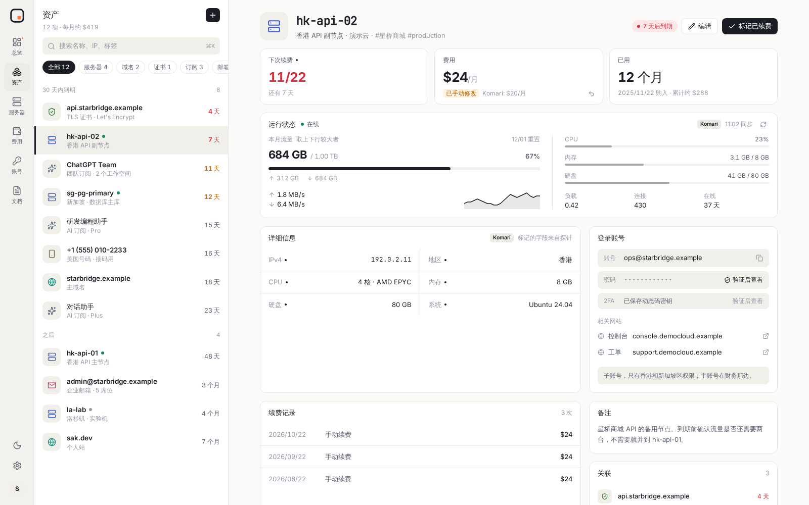
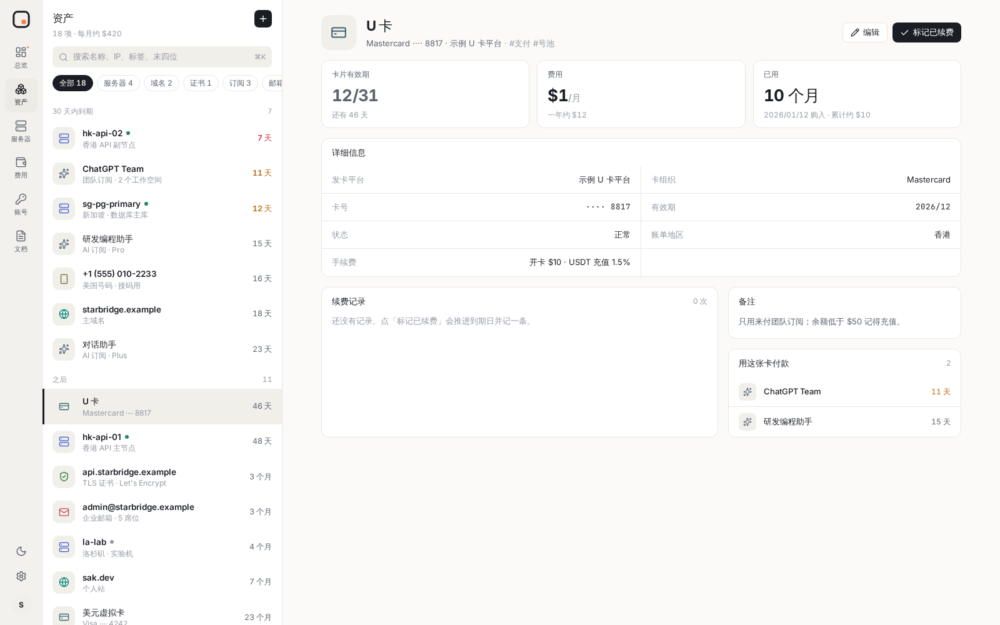

<p align="center"></p>

<h1 align="center">方寸 Fangcun</h1>

<p align="center">个人资产台账 —— 服务器、域名、证书、订阅、邮箱、号码、支付卡、账号、文档的<b>到期与费用</b>，一处管理。</p>

<p align="center">自托管 · 单用户 · SQLite · 只读接入 Komari 探针 / CLIProxyAPI 额度 · CLI / MCP 给 AI 代理用 · MIT</p>


## 方寸是什么

手上的东西一多——几台 VPS、一堆域名和证书、AI 订阅、团队席位、虚拟卡、接码号码——就很难记清楚**哪个快到期、每月到底花多少、谁用哪张卡付的**。方寸把它们放进一张台账：

- **统一资产列表**：9 种类型（服务器 / 域名 / 证书 / 订阅 / 邮箱 / 号码 / 支付 / 账号 / 文档），按到期日排序，类型筛选、全文搜索（名称、IP、标签、卡号末四位…）。
- **到期提醒**：红色 = 7 天内（含已过期），橙色 = 14 天内，其余保持中性。「标记已续费」会把到期日推进一个周期并记一条续费记录。
- **标签**：任意自定义（如 香港、甲骨文、Google 账号）。资产列表在类型下面列出当前类型用到的标签，点选即筛选，多选时须同时带有这些标签；编辑时下方会列出已有标签，点一下即可加上，回车或逗号添加新标签。搜索框输入 `#标签` 也能找。
- **手动续期窗口**：免费域名这类「到期前 N 天才能续」的资产，在编辑里填「到期前可续期 N 天」。提醒改按窗口打开那天算：打开前按剩余天数变色，打开后显示「可续期」并保持红色，直到「标记已续费」；续费日历也会多一条「可以续期了」。只对没开自动续费的资产生效。
- **费用**：价格一律**按实付手填**（区域价、折扣都按你真正付的钱记），币种、周期、区域 / 折扣标签自己写，单项价格**不做换算**；总览里的「约」合计按汇率折算，汇率默认每 6 小时自动更新（欧洲央行参考汇率 via Frankfurter，缺的币种用 open.er-api 补，无需密钥），也可以在设置里关掉改成手填。
- **团队订阅**：母号 → 工作空间（各自价格、区域、折扣、席位、到期）→ 成员。资产总价 = 各空间合计，到期 = 最早到期的空间，显示人均成本。
- **支付卡**：发卡平台、卡组织、**卡号末四位**、有效期（参与到期提醒）、年费 / 月费、开卡费 / 充值手续费、账单地区、状态（正常 / 冻结 / 已注销）。通过「关联」挂到订阅、服务器上表示用这张卡付款。**方寸绝不保存完整卡号和 CVV**——服务端会拒绝任何看起来像完整卡号（13–19 位且通过 Luhn 校验）或名为 cvv / cardNumber 的字段。
- **号码**：号码、运营商 / 平台、国家、用途、保号 / 续费到期、月租。
- **关联、标签、备注、附件**：文档类资产可以上传合同、发票等附件，随完整备份一起导出。
- **服务器页**：在线数、实时带宽、本月流量、每月成本，以及每台机器的 CPU / 内存 / 硬盘 / 流量 / 负载卡片（数据来自 Komari，由方寸服务端转发）。
- **Atoll 只读接入**：读取 Atoll 面板的项目 / 服务 / 域名，VPS 详情里看到「这台机器上跑着哪些项目」，域名详情里看到「哪些服务指向这个域名」，快到期时提示「影响 N 个 Atoll 项目」。

方寸只是台账：**不做 SSH、终端、SFTP，不采集监控，不对任何服务器做任何操作。**

| 服务器 | 服务器详情 | 支付卡 |
| --- | --- | --- |
|  |  |  |

## 快速开始

### Docker（推荐）

镜像：`ghcr.io/sakuralaaa/fangcun:latest`（amd64 / arm64，每次发版打 `v*` 标签时自动构建，同时有 `latest` 和版本号标签，如 `0.1.0`）。

在任意 Docker 面板里直接拉这个镜像即可，要点：

- 端口：容器 `8080`
- 数据卷：容器 `/data`（数据库、附件、自动备份都在这里，务必挂载）
- 环境变量（可选）：`KOMARI_API_KEY`（Komari 管理员 API Key，只读使用）、`ATOLL_API_KEY`（Atoll 只读令牌，见下文「Atoll 接入」）、`CLOUDFLARE_API_TOKEN` / `CLOUDFLARE_ACCOUNT_ID`（Cloudflare 只读令牌，见下文「Cloudflare 接入」）、`TZ=Asia/Shanghai`、`COOKIE_SECURE=1`（走 HTTPS 反代时）

或用 compose：

```bash
mkdir fangcun && cd fangcun
curl -fsSLO https://raw.githubusercontent.com/Sakuralaaa/fangcun/main/docker-compose.yml
echo "KOMARI_API_KEY=你的 Komari API Key" > .env   # 可选
echo "ATOLL_API_KEY=atl_pat_你的只读令牌" >> .env    # 可选
echo "CLOUDFLARE_API_TOKEN=你的只读令牌" >> .env     # 可选
docker compose up -d
```

打开 `http://服务器:8080`，**第一次访问时设置管理员账号和密码**（单用户，密码 scrypt 哈希存储），之后可在「设置 → 登录与两步验证」绑定 TOTP。

想自己构建：

```bash
docker buildx build --platform linux/amd64,linux/arm64 -t fangcun:latest .
```

放在 HTTPS 反向代理（Caddy / Nginx）后面时建议设 `COOKIE_SECURE=1`；代理会转发 `X-Forwarded-Proto: https` 时会自动带 Secure。

### 从源码运行

需要 Node.js ≥ 22.13（使用内置的 `node:sqlite`，无需编译原生模块）。

```bash
npm install
npm run build          # web + server + cli
npm test               # vitest
FANGCUN_DATA_DIR=./data KOMARI_API_KEY=xxx npm start   # http://localhost:8080
```

开发模式：`npm run dev:server`（8080）+ `npm run dev:web`（Vite，自动把 /api 代理到 8080）。

不连服务端、只看界面：打开 `http://localhost:5173/?demo=1`（演示数据，改动只留在浏览器内存里）。

### 环境变量

| 变量 | 默认 | 说明 |
| --- | --- | --- |
| `PORT` / `HOST` | `8080` / `0.0.0.0` | 监听地址 |
| `FANGCUN_DATA_DIR` | `./data`（镜像里 `/data`） | 数据库、附件、备份 |
| `FANGCUN_BACKUP_DIR` | `$FANGCUN_DATA_DIR/backups` | 自动备份目录 |
| `KOMARI_API_KEY` | — | Komari 管理员 API Key，只放在服务端，不进数据库、不进备份 |
| `ATOLL_API_KEY` | — | Atoll 的**只读（read）**API 令牌（`atl_pat_…`），只放在服务端，不进数据库、不进备份、不发给浏览器 |
| `CLOUDFLARE_API_TOKEN` | — | Cloudflare 的**只读**API 令牌（只勾 Read 权限），只放在服务端，不进数据库、不进备份、不发给浏览器、不写日志 |
| `CLOUDFLARE_ACCOUNT_ID` | — | 可选。只读这个账户；账户令牌（`cfat_…`）必须设置 |
| `COOKIE_SECURE` | 自动 | `1` 强制 Secure cookie，`0` 关闭 |
| `TZ` | 系统 | 每日自动备份按此时区判断日期 |

读取 `KOMARI_API_KEY` / `ATOLL_API_KEY` / `CLOUDFLARE_API_TOKEN` / `CLOUDFLARE_ACCOUNT_ID` 时会自动去掉首尾空白和换行、成对包裹的引号（docker-compose 列表写法 `- X="..."` 会把引号带进值）以及误粘贴的 `Bearer ` 前缀。**改了环境变量后要重建容器**（`docker compose up -d --force-recreate`），只 `restart` 不会读到新值。

## 界面说明（界面上不再重复）

- **常规 / 汇率**：价格一律按实付手填，不做换算；汇率只用于总览、费用页里的「约」合计。自动更新时每 6 小时从欧洲央行参考汇率（Frankfurter）拉取，缺的币种用 open.er-api 补；关闭后每行写 `币种=数值`（1 个合计币种可兑换多少该币种）手动维护。
- **登录与两步验证**：单用户，只有你自己的管理员账号。开启 TOTP 后登录需要动态码；网页里备份、导出、恢复和调整自动备份设置前也要再输一次动态码（10 分钟内有效）。改密码会退出其他设备上的登录。
- **变更审批**：「可写」令牌提交的改动停在这里，批准后才写入；冲突的计划不会覆盖之后的修改。
- **操作日志**：所有写入都会记录（包括 CLI、AI 代理和 Komari 同步），可以逐条撤销。
- **回收站**：删除的资产保留 30 天，之后自动永久删除。
- **备份**：完整备份 `.fangcun` 见下文「备份、导出与恢复」；建议先开启两步验证。可读导出不含任何密码。
- **第一次登录**：方寸是单用户应用，首次设置的管理员账号就是你自己的，密码用 scrypt 哈希保存。
- **资产编辑**：「费用与到期」按实付手填，不做汇率换算；「Komari」按 uuid 绑定后，价格、到期、配置、IP 从探针同步；「卡片」只保存卡号末四位，绝不保存完整卡号和 CVV；「账号」网页版不保存密码（端到端加密保险库见路线图）；「团队订阅」是母号 → 工作空间 → 成员，总价和到期由各空间汇总，成员邮箱每行一个，母号自动算一席。
- **资产详情**：「标记已续费」会把到期日推进一个周期并记一条续费记录；文档类资产的附件（合同、发票、证书文件）随完整备份一起导出。服务器以外的资产详情是居中的单栏：「时间线」按日期列出购入 / 开卡、每次续费（金额、改到的到期日；超过 5 次时先收起更早的）、今天、手动续期窗口打开日、到期日（下次扣费金额）和按当前周期续费后的到期日；下面是详细信息、登录账号、关联资产和备注。服务器详情保持原来的宽版仪表盘。
- **资产列表**：类型用一个下拉框切换（含「全部」「关注」和各类型数量）；标签筛选收在「标签」按钮里，默认收起，已选标签在收起时仍显示在搜索框下方，可一键清除；每行只显示名称、在线点、置顶标记和剩余时间，用途（subtitle）悬停可见。
- **费用页**：各币种分开合计，其他币种按设置里的汇率估算折合。
- **服务器页**：到「设置 → Komari 探针」把节点一键导入，或在资产里手动添加服务器。
- **总览**：问候语下只放三个数（30 天内到期、每月支出、探针在线，点了分别跳到资产、费用、服务器页；悬停可见手动续费数、年支出、更新时间），主体是「这周要续」和「即将到期（45 天内）」两组列表。「关注」「每月支出构成」「探针」收成右侧三张小卡，默认收起，标题行显示项数 / 月支出 / 在线数，展开状态记在本机（localStorage `fc-overview-open`）。
- **总览「关注」**：在资产列表里点星标关注的资产，到期和在线状态集中显示在这里。

## 关注与置顶（v0.1.6）

- 资产列表每行右侧有星标（悬停或已关注时显示，键盘可达），点一下「关注」；资产详情标题旁也有星标，「更多」菜单里可「置顶 / 取消置顶」。
- **置顶隐含关注**：置顶一项会同时关注它；取消关注会同时取消置顶。
- 资产列表：置顶项排最前（单独一组），其次照原到期紧急度；筛选标签里有「关注 N」。总览有「关注」区块（30 天内到期的关注项最先），服务器页关注的节点排前并显示星标。
- 关注 / 置顶只由你改动：Komari / Atoll / Cloudflare 同步、资产编辑表单都不会覆盖它们；导入导出（CSV 列 `starred` / `pinned`、JSON）与备份都带上，旧数据默认不关注。
- CLI：`fangcun ls --starred`、`fangcun star|unstar|pin|unpin <id>`；MCP：`list_assets` 的 `starred_only`、`set_focus`。权限同其他写操作（可写令牌生成变更计划）。

## Komari 接入（只读）

适配 Komari 1.2.5。在「设置 → Komari 探针」填写探针地址，API Key 由服务端环境变量 `KOMARI_API_KEY` 提供。

Komari 的 API Key 在它的管理后台「设置 → 登录」页最下方的「API 密钥」里点「生成」再保存（以 `komari-` 开头）。这把密钥在 Komari 那边是完整管理权限，方寸只用它读取节点列表和状态，请只放在环境变量里。

- **方寸只会发出下面这些只读请求**，其余在发出前就被代码拦截（并有测试保证）：
  - `GET /api/admin/client/list` —— 节点信息（响应里的 agent token 一到就丢弃，从不存储或转发）
  - `POST /api/rpc2`，方法仅限 `common:getNodesLatestStatus`（运行状态）和 `common:getVersion`
  - `POST /api/rpc2` 的 `common:getRecords`，参数只允许 `type: "ping"`（近 1 小时延迟记录，每分钟最多一次）；Komari 里没有延迟检测任务或接口不可用时，服务器页隐藏延迟/丢包行
  - 绝不调用任何写接口、exec 或终端接口。
- **按 uuid 绑定**：节点可以绑到已有的服务器资产，或一键新建。
- **同步字段**（每组可在设置里开关）：价格与币种、续费周期、到期日、自动续费、配置与系统（CPU / 内存 / 硬盘 / OS）、IP 与地区、标签。
- 设置里关掉的字段只在方寸里维护，不再以 Komari 为准。
- **已手动修改**：你在方寸里改过的同步字段会标「已手动修改」，之后同步不会覆盖；Komari 那边的值变了会提示「Komari 已变为 …」，可一键恢复。
- **运行状态**：浏览器只连方寸，不直连 Komari。有人在看时前端每 10 秒轮询，方寸服务端合并请求、8 秒内复用；没人看时后台每 5 分钟刷新一次缓存。
- **服务器页**：在线节点、累计流量、实时带宽、资产概览（按设置里的汇率换算）四张汇总卡；按 Komari 分组（没有分组时按标签）筛选；大卡片 / 紧凑卡片 / 列表三种布局（记在本机）。CPU、内存、磁盘、负载、剩余流量用分段条显示，80% 以上转橙、90% 以上转红。
- **流量重置日**在方寸里手填（资产编辑 → Komari → 流量重置日）。流量用量按 Komari 的 `traffic_limit_type`（sum / max / min / up / down）计算。

## 访问令牌与权限

「设置 → 访问令牌」可以生成给 CLI / AI 代理用的令牌：可命名、可设过期、可随时吊销，明文只显示一次（库里只存 SHA-256）。

| 权限 | 能做什么 |
| --- | --- |
| **只读** | 查询、搜索、导出、doctor |
| **可写（需审批）** | 所有写操作先生成**变更计划**，在网页「设置 → 变更审批」里看到逐字段 diff，批准后才落库；计划生成后资产又被改过则判为冲突，不会覆盖 |
| **完全权限** | 直接写入（含删除到回收站、改 Komari 绑定、备份 / 恢复） |

无论哪种：

- 令牌**不能**管理令牌、批准计划、改登录设置；
- 所有写入（网页、CLI、AI 代理、Komari 同步）都记**操作日志**，可以逐条**撤销**；
- 删除先进**回收站，30 天**后自动永久删除；
- 账号类资产在 v0.1 不存任何密码（保险库见路线图），API 也不会返回密钥类字段。

## CLI：`fangcun`

```bash
npm run build -w apps/cli         # 生成 apps/cli/dist/fangcun.js（单文件）
alias fangcun="node $PWD/apps/cli/dist/fangcun.js"   # Docker 镜像里已自带 fangcun 命令

fangcun config --url https://fangcun.example.com --token fc_xxx   # 或 FANGCUN_URL / FANGCUN_TOKEN
fangcun ls --due 30                       # 30 天内到期
fangcun ls --type payment --json
fangcun show hk-api-02
fangcun search 192.0.2
fangcun add --type domain --name example.dev --price 12 --currency USD --cycle year --expires 2027-06-11 --tags 个人
fangcun add --type payment --name "美元虚拟卡" --set payment.issuer=某数字银行 --set payment.network=Visa \
            --set payment.last4=4242 --set payment.cardExpiry=2028-09 --set payment.status=active
fangcun edit hk-api-02 --set price=24 --set note="续费前确认流量"
fangcun tag ai-chat +个人 -工作
fangcun link ai-code card-wise            # 双向关联：这个订阅用这张卡付款
fangcun renew starbridge --amount 88 --note 手动续费
fangcun star hk-api-02                    # 关注；pin 置顶（同时关注），unstar 取消关注（同时取消置顶）
fangcun rm la-lab                         # 进回收站
fangcun import assets.csv                 # 或 .json
fangcun export --format csv -o all.zip    # json | csv | ics
fangcun doctor                            # 缺字段、重复、过期未处理、无关联、断开的关联
fangcun log --limit 20
fangcun undo 42
fangcun plans                             # 待审批的变更计划
fangcun backup -o fangcun.fangcun         # 需要完全权限令牌
fangcun restore fangcun.fangcun --dry-run # 预览差异；--mode merge | replace 执行
```

所有命令支持 `--json`，默认输出人读表格。

### MCP：给 Codex / Claude Code 用

`fangcun mcp` 以 stdio 方式运行 MCP server，暴露同样的能力（list_assets、search_assets、get_asset、create_asset、update_asset、tag_asset、link_assets、renew_asset、delete_asset、doctor、audit_log、undo、import_assets、pending_plans、set_focus），权限由令牌决定——建议给 AI 代理用「可写（需审批）」令牌。

```jsonc
// Claude Code: .mcp.json   /   Codex: ~/.codex/config.toml 里 [mcp_servers.fangcun] 同理
{
  "mcpServers": {
    "fangcun": {
      "command": "node",
      "args": ["/path/to/fangcun/apps/cli/dist/fangcun.js", "mcp"],
      "env": { "FANGCUN_URL": "https://fangcun.example.com", "FANGCUN_TOKEN": "fc_..." }
    }
  }
}
```

字段含义与整理规范见 [AGENTS.md](AGENTS.md)。

## 备份、导出与恢复

- **完整备份 `.fangcun`**：zip，内含 `manifest.json`（格式、schema 版本、应用版本、时间、每个文件的 SHA-256）、`data.json`（全部资产含回收站、字段、手改标记、续费记录、关联、标签、团队空间、设置）、`attachments/`、`audit.jsonl`（操作日志）。读取时逐个校验和，被改动或损坏会直接拒绝。
- **恢复前预览**：新增 / 冲突（列出字段、哪边更新）/ 相同 / 仅当前库有。
  - **合并**：加入新增项，冲突取更新时间较新的一方；
  - **整库替换**：替换前**自动给当前库打一份快照**（`backups/pre-restore-*.fangcun`）。
- **跨版本**：data.json 带 schema 版本号，旧备份恢复时自动迁移；更新版本的备份会提示先升级。
- **可读导出**：CSV（按类型分表打包；同一套列可再导入）、JSON、续费日历 ICS（每个到期日一个全天事件，提前 7 天和 1 天提醒）。导出不含任何密码。
- **自动备份**：每天一次写到服务端备份目录，默认保留最近 30 份；失败会在总览顶部提示。
- **两步验证保护**：绑定 TOTP 后，网页端下载备份、导出、恢复、调整自动备份设置前需要再输一次动态码（10 分钟内有效）。CLI 备份 / 恢复需要完全权限令牌。

## Atoll 接入（只读）

Atoll 是自托管的多 VPS 容器面板。方寸只读取它的服务器、项目、服务和域名，和台账里的 VPS、域名对上号。

**部署步骤：**

1. 在 Atoll 面板左侧点「连接」→「API 令牌」→「创建令牌」，权限预设选 **「只读」**（只勾 read，默认的「部署」不要用），项目范围选「所有项目」，创建后复制只显示一次的 `atl_pat_…`。
2. 把它设为方寸服务端的环境变量 `ATOLL_API_KEY`（compose 里取消注释那一行，写进 `.env`），重建容器（`docker compose up -d --force-recreate`）。
3. 在方寸「设置 → Atoll 面板」填写面板地址（如 `https://atoll.example.com`），选同步间隔（5 / 15 / 30 分钟或每小时），点「立即同步」。

**安全约束：**

- 服务端的 Atoll 客户端**只能发 GET**，路径白名单仅 `/api/v1/auth/me`、`/servers`、`/projects`、`/projects/{id}`、`/domains`；其他方法、路径、查询串在发出前就被代码拒绝（有单测覆盖）。不调用 exec、变量明文、日志、事件流或任何写接口。
- 每次同步先请求 `GET /auth/me` 读出令牌权限；**权限里有 read 以外的任何一项（deploy、exec…）就拒绝使用**，设置页提示「这个 key 不是只读」。读不到时（较旧的 Atoll）照常同步，并提醒你自己确认是只读令牌。
- 只保存一份精简快照（服务器名 / 状态 / 公网 IP、项目、服务名 / 镜像 / 状态、域名），环境变量、端口、卷等字段一到就丢弃。

**怎么对上号：**

- **VPS ↔ Atoll 服务器**：Atoll 上报的公网 IPv4 / IPv6 等于资产「详细信息」里任一 IP 行（标签含 IP 的行，如 IPv4、IPv6、公网 IP；含 Komari 同步来的 IP；IPv6 按规范形式比较）。一个 IP 同时对上多项时不自动关联。对不上可以在 VPS 详情的「Atoll 上的项目」卡片右上角手动选（或设为「不关联」），**手动优先**，存在资产的 `atoll.serverId` 上。
- **服务域名 ↔ 域名资产**：按后缀匹配，取最长的那个：`blog.example.com` → 域名资产 `example.com`；同时有 `shop.example.com` 资产时 `api.shop.example.com` 归它。
- 关联是即时算出来的视图，**不写进资产的「关联」，也不改任何手填数据**。

## Cloudflare 接入（只读）

方寸只读读取 Cloudflare 的 zone、A / AAAA / CNAME 记录、注册商域名、Tunnel、Workers、Pages 和 R2，和台账里的域名、VPS、Atoll 项目对上号。不改 Cloudflare 上的任何东西。

**部署步骤：**

1. Cloudflare 面板 → 右上角头像「我的个人资料」→「API 令牌」→「创建令牌」→「创建自定义令牌」，**全部选 Read**：
   - 账户：Account Settings · Read（设置了 `CLOUDFLARE_ACCOUNT_ID` 可不勾）、Registrar Domains · Read、Cloudflare Tunnel · Read、Workers Scripts · Read、Cloudflare Pages · Read、Workers R2 Storage · Read
   - 区域：Zone · Read、DNS · Read（区域资源选「所有区域」或指定区域）
   - 用户（可选）：API Tokens · Read —— 让方寸核对令牌自身是否只读；不勾则设置页提示你自检
2. 设为服务端环境变量 `CLOUDFLARE_API_TOKEN`（可选 `CLOUDFLARE_ACCOUNT_ID`；`cfat_` 开头的账户令牌必须设置），重建容器（`docker compose up -d --force-recreate`）。也可以直接用 Cloudflare 的「Read all resources」模板。
3. 「设置 → Cloudflare」点「立即同步」。之后每 10 分钟最多自动刷新一次。

**安全约束：**

- 服务端客户端**只能发 GET**，路径与查询参数都有白名单（`/user/tokens/verify`、`/accounts`、`/zones`、`/zones/{id}/dns_records`、`/accounts/{id}/registrar/registrations`（旧 `/registrar/domains` 兜底）、`/cfd_tunnel` 及其 `configurations` / `connections`、`/workers/scripts`、`/workers/domains`、`/pages/projects`、`/r2/buckets`；查询参数只允许 `page` / `per_page` / `cursor` / `is_deleted=false`），其他请求在发出前就被拒绝（有单测覆盖）。
- 每次同步先校验令牌；能读到令牌权限时按**权限组名末尾的访问级别**判断：以 Read / Reader 结尾（忽略大小写、尾部空白和括号注释）一律只读（如「Browser Run Read」）；以 Edit / Write 结尾或末尾是 Purge、Revoke、Admin、Run 这类动作的算写，**含任何写权限就拒绝使用**；另有几个官方只读组不以 Read 结尾（Security Center Insights、Zero Trust Report、Packet Captures - Read PCAPs API）。其他无法判断的不拒绝，在设置页列为「无法判断，请自查」。读不到权限时照常同步并提醒你自检。
- 令牌被拒（401/403）时，提示里会给出令牌类型（只显示前 5 个字符：`cfat_` 账户令牌 / `cfut_` 或旧格式用户令牌）、长度是否异常、是否自动去掉了引号等，`cfat_` 而没设 `CLOUDFLARE_ACCOUNT_ID` 会明确提示；令牌若设置了「客户端 IP 地址筛选」，要包含方寸服务器的出口 IP。
- 缺某项权限只把那一项标为「未授权」，其他照常。只存一份精简快照，TXT / MX 等记录、令牌、凭据一到就丢弃。

**怎么对上号（只是视图，不写进资产）：**

- zone ↔ 域名资产按域名匹配；在 Cloudflare 注册的域名，到期日与自动续费作为「来自 Cloudflare」的建议值显示，点「采纳」才写入，之后仍可在方寸里改。没有对应资产的 zone 在设置页列出，点「导入」才建域名资产。
- A / AAAA 记录按公网 IP 对应唯一一台 VPS（IP 写在多台机器上就不猜）；CNAME 指向 `*.cfargotunnel.com` 的记录对应到 Tunnel，再按 Tunnel 连接的来源 IP 对应 VPS。
- Atoll 项目卡和域名详情里显示每个主机名在 Cloudflare 的记录、是否代理、是否走 Tunnel，并标出不一致（没有记录、记录指向的不是项目所在服务器、Tunnel 跑在别的机器上）。
- Workers、Pages、R2 只显示，不建资产；它们的自定义域名会挂到对应的域名资产上。

## CLIProxyAPI 接入（只读）

在 CLIProxyAPI 里装上本仓库自带的「方寸」插件，方寸就能读到那台 CLIProxyAPI 号池里 **Codex** 和 **Google Antigravity** 账号的套餐、状态和各额度窗口（Codex：5 小时 / 每周或每月；Antigravity：按模型分组的 5 小时 / 每周等），挂到对应的订阅和团队成员上。号池分散在几台 CLIProxyAPI 上时，每台各加一个连接即可。

**安装插件：**

1. CLIProxyAPI 管理面板 →「配置」→ 第三方插件源（`plugins.store-sources`）里添加：
   `https://raw.githubusercontent.com/Sakuralaaa/fangcun/main/registry.json`
   （必须是这个 raw 地址：CLIProxyAPI 会把插件源地址原样当作 JSON 下载，填仓库主页 `https://github.com/Sakuralaaa/fangcun` 拿到的是网页，插件商店里看不到插件。）
2. 插件商店里找到「方寸额度只读接口」，安装并启用。插件随方寸每次发版（`v*` 标签）一起构建，linux amd64 / arm64，适用于官方 Docker 镜像（glibc）。
3. 管理面板左侧出现「方寸」页面：「地址」默认是你打开管理面板用的地址，方寸访问 CLIProxyAPI 走的地址不同就改一下；点「复制」拿到连接串。
4. 方寸「设置 → CLIProxyAPI」→「添加」，填名称（如「家里 NAS」）、备注，粘贴连接串，可先点「测试」，再「保存」。

**安全约束：**

- 插件只注册两类东西：管理接口（`/v0/management/fangcun/connection`、`/fangcun/token/rotate`，受 CLIProxyAPI 管理密钥保护，只给面板取 / 换令牌）和资源路由（面板页面、只读额度接口 `/v0/resource/plugins/fangcun/feed`）。资源路由不经过 CLIProxyAPI 的管理密钥，额度接口用插件自己的**只读令牌**（`fcq_…`，32 字节随机数，存在 CLIProxyAPI 凭证目录的 `.fangcun-feed` 里）鉴权，只认请求头 `Authorization: Bearer` 或 `X-Fangcun-Token`，不认查询串里的令牌（免得进访问日志）。没有令牌或令牌不对一律 401。
- 这个令牌只能读额度，不能调用模型、不能读管理接口。面板里「重新生成」后旧连接串立即失效。
- 额度接口只返回：账号 id（CLIProxyAPI 的 auth_index）、类型、邮箱、标签、CLIProxyAPI 里的备注、套餐、状态、各窗口已用百分比和重置时间。**任何账号的 access / refresh token、账号 id、项目 id、文件路径都不会出现在响应里**（插件有单测保证）。插件读额度时在 CLIProxyAPI 进程内用凭证调用上游（Codex `wham/usage`；Antigravity `loadCodeAssist` 与 `retrieveUserQuotaSummary`），走 CLIProxyAPI 自己的代理设置；结果缓存 5 分钟，强制刷新至少间隔 60 秒。已停用的账号不会去读。
- 方寸这边：连接串里的令牌只存在服务端数据库的单独一张表（`cliproxyapi_connections`）里，不进设置、不进完整备份和任何导出、不写日志、不发给浏览器；任何 API（网页登录或访问令牌）都只返回连接的名称、备注、地址、上次读取时间和错误。所以恢复备份后需要重新粘贴连接串。方寸对 CLIProxyAPI 只发 `GET <地址>/v0/resource/plugins/<插件 id>/feed` 这一个请求，不跟随重定向。添加、修改、删除连接只能在网页登录后操作；只读访问令牌可以读额度（CLI / AI 代理）。
- 方寸每 10 分钟读一次所有连接，设置页可以单个或全部手动刷新。

**怎么对上号（即时算出来的视图，不改资产）：**

- 订阅：资产关联的登录账号（「账号」资产的用户名）、详细信息里任意一行邮箱、团队订阅的母号和成员邮箱，与号池账号邮箱相同（不区分大小写）即关联；几台 CLIProxyAPI 上的同一个邮箱都会列出，每行标明来自哪个连接（你起的名字）。
- 团队成员：成员邮箱等于账号邮箱，工作空间卡片里显示该成员的 5 小时 / 每周剩余。
- 手动关联：资产的 `quotaBinds`（`[{ provider, email, member? }]`，`member` 填成员邮箱即挂到那位成员上），用 CLI / API 编辑资产即可写入；网页编辑入口见路线图。

## 项目结构

```
packages/core   类型与 schema 版本、到期 / 紧急度 / 费用计算、Komari 字段映射、Atoll / Cloudflare 关联（IP / 域名后缀 / Tunnel 匹配）、备份格式、CSV / ICS、doctor、权限判定
apps/server     Node 22 + Hono + node:sqlite；迁移、登录 / 会话 / TOTP、令牌、变更计划、审计与撤销、Komari 只读转发、Atoll 与 Cloudflare 只读快照、备份
apps/web        React 19 + Vite + Tailwind v4 + lucide；?demo=1 为演示模式
apps/cli        fangcun 命令与 stdio MCP server（esbuild 打成单文件）
plugins/cliproxyapi  CLIProxyAPI 插件（Go，c-shared）：只读额度接口 + 连接串面板；registry.json 在仓库根目录
```

测试（vitest）覆盖：到期与费用计算、支付卡 / 号码校验、Komari 映射与手改保护（伪造的 1.2.5 响应）、Atoll / Cloudflare 只读白名单与非只读令牌拒绝、Cloudflare 分页与单项降级、IP / 域名后缀匹配与手动绑定优先、备份往返与篡改检测、schema 迁移、令牌三档权限与审批流程、撤销与回收站、2FA 二次验证、MCP 协议。

## 开发约定

- **界面只留操作要用的字**：按钮、字段名、状态、错误和必要的空状态。用途解释、原理说明、安全承诺这类文字一律写进本 README，不放在界面上；同一句提示在一个页面上只出现一次。
- 图标、次要文字与背景的对比度不低于 3:1（深浅两套主题都要满足）；`text-subtle` 只用于非必要的辅助文字，不用于可点击的图标。

## 路线图

- **v0.2 密码保险库（端到端加密）**：主密码在客户端用 Argon2id 派生密钥，服务器只存密文；网页查看需动态码 + 主密码，验证后 5 分钟免验证、明文 30 秒自动隐藏、查看记日志；离线恢复码；备份内只含密文。数据模型已为账号预留 `secret` 字段。
- **桌面版（Electron）**：本地 SQLite，可离线使用，与网页服务端同步。
- **手机 App**：查看到期、标记续费，受信设备免二次验证。
- CLIProxyAPI：网页里手动关联 / 取消关联号池账号，CLI / MCP 的额度查询命令。
- 备份推送到 WebDAV / S3 兼容存储、到期通知渠道。

## License

[MIT](LICENSE) © 2026 Sakuralaaa
